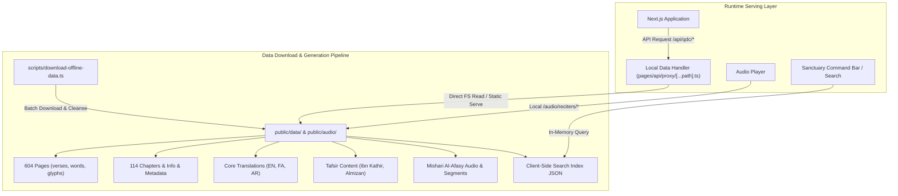

# Offline Data & Self-Contained CDN Architecture Design Specification

**Date:** 2026-09-10  
**Status:** Approved  
**Author:** Antigravity Pairing Assistant  

---

## 1. Overview & Objective

The objective is to eliminate all runtime dependencies on the external **QuranCDN API** (`api.qurancdn.com`, `quran.com`, `audio.qurancdn.com`), transitioning Quran.ir into a **100% self-contained, offline-capable application**. All Quranic texts, Mushaf pages (1–604), Surahs (1–114), Juzs (1–30), core translations (English, Persian, Arabic), Tafsir data, audio recitations, and search indexes will be downloaded, pre-generated as static assets in `public/data/` and `public/audio/`, and served locally or via Quran.ir's own self-hosted CDN.

---

## 2. Architecture & Data Flow

---

## 3. Detailed Specifications

### 3.1 Offline Data Assets & Structure
All static datasets will reside in `public/data/qdc/`:
1. **Pages (`/public/data/qdc/verses/by_page/{1..604}.json`)**:
   - Contains all verses on each page with words, line numbers, page numbers, word transliteration, translation, and glyph codes (`code_v1`, `code_v2`, `qpc_uthmani_hafs`).
2. **Chapters (`/public/data/qdc/chapters/{1..114}.json` & `by_chapter/{1..114}.json`)**:
   - Chapter info, revelation place, verses count, transliterated names, bismillah status.
3. **Juzs (`/public/data/qdc/verses/by_juz/{1..30}.json`)**:
   - Verses grouped by Juz bounds.
4. **Pages Lookup (`/public/data/qdc/pages/lookup.json`)**:
   - Mushaf page ranges, from/to verse keys for all 604 pages across Mushaf versions.
5. **Translations (`/public/data/qdc/resources/translations/`)**:
   - Available translation list and full translation texts for:
     - English: Saheeh International, Bridges Translation, Abdel Haleem.
     - Persian (Farsi): Makarem Shirazi, Ansariyan, Khorramshahi.
     - Arabic: Tafsir Al-Muyassar.
6. **Tafsirs (`/public/data/qdc/resources/tafsirs/` & `tafsirs/{id}/by_ayah/`)**:
   - Ibn Kathir English & Almizan / Nemoneh.
7. **Audio Recitations (`/public/audio/reciters/{reciterId}/`)**:
   - Default reciter (Mishari Rashid Al-Afasy) chapters audio MP3s and timestamp segmentation JSON.
8. **Offline Search Index (`/public/data/search/search-index.json`)**:
   - Pre-computed tokenized search index containing surah names, translations, keywords, and verse keys for client-side search without external backend calls.

### 3.2 Runtime Interception & Local Serving
1. **API Host (`src/utils/api.ts`)**:
   - Replace remote `PRODUCTION_API_HOST` (`https://api.qurancdn.com`) with relative root `""` or local proxy URL.
2. **Local API Proxy (`src/pages/api/proxy/[...path].ts`)**:
   - Rewrite the proxy route to load data from `public/data/qdc/` or local memory cache, eliminating external network calls.
   - Fallback to local static JSON if any specific parameter is requested.
3. **Audio URL Resolver (`src/utils/audio.ts` & `src/utils/apiPaths.ts`)**:
   - Route audio file requests to `/audio/reciters/...` on the local origin.

---

## 4. Verification & Testing Gate

1. **Strict Offline Playwright Gate**:
   - Configure a Playwright end-to-end test suite that strictly blocks and fails on any outbound request to `*.qurancdn.com`, `*.quran.com`, or external domains.
   - Verify that:
     - Surah `/1`, `/6`, `/18`, `/36`, `/114` load with complete Arabic text and translations.
     - Reading Mode (Arabic & Translation book format) displays complete text.
     - Page `/page/1` and `/page/604` render full Mushaf layouts.
     - Audio Player streams from local audio files.
     - Search Command Bar executes searches instantly without external API errors.
2. **Type Safety & Build**:
   - Run `npx tsc --noEmit` to verify 0 type errors.
   - Run `yarn test` to ensure all existing test suites pass.

---
