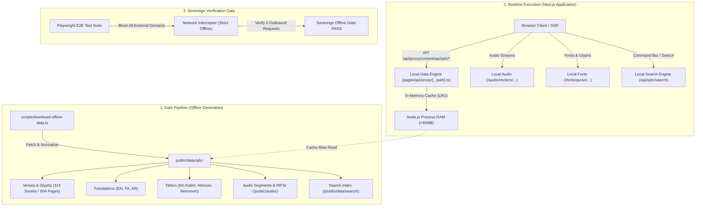
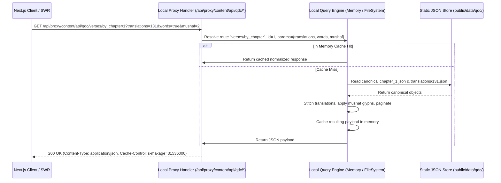
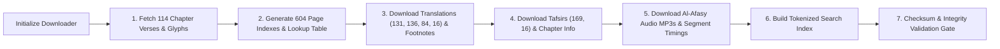

# Offline Data & Self-Contained CDN Architecture Design Specification

**Date:** 2026-09-10  
**Status:** Approved  
**Author:** Antigravity Systems & Principal Architecture Team  
**Scope:** Core Quran Web Platform (Quran.ir / Next.js)

---

## 1. Executive Summary & Architectural Goals

The primary objective of this architecture is to transition Quran.ir from an external-API-dependent web application into a **100% self-contained, offline-first, sovereign digital sanctuary**. 

Currently, runtime operations rely on external services operated by third parties:
- `api.qurancdn.com` (Verse text, translations, tafsirs, metadata, search)
- `static.qurancdn.com` (Reciter images, tajweed glyphs)
- `audio.qurancdn.com` (Recitation MP3 streams, word-by-word audio snippets)
- `og.qurancdn.com` (OpenGraph social preview cards)
- `quran.foundation` (External authentication / donation links)

This design completely eliminates runtime dependencies on these external endpoints. All Quranic datasets (604 pages, 114 surahs, 30 juzs, translations, tafsirs, reciter audio, and search indexes) are normalized into canonical static datasets in `public/data/qdc/` and served locally via a high-performance **Local Data Engine & Proxy** (`src/pages/api/proxy/[...path].ts`) and static asset directories.



---

## 2. Codebase & Endpoint Inventory Analysis

An exhaustive audit of `src/` identified all API paths, query parameters, font loaders, audio players, and static resources:

### 2.1 Complete Endpoint & Parameter Matrix

| Path Pattern | Handler / Utility | Query Parameters Handled | Upstream Data Source |
| :--- | :--- | :--- | :--- |
| `/verses/by_chapter/:id` | `makeVersesUrl` | `words`, `mushaf`, `translations`, `translation_fields`, `word_fields`, `word_translation_language`, `per_page`, `page`, `from`, `to`, `filter_page_words` | `verses/by_chapter/{id}.json` + `translations/{id}.json` |
| `/verses/by_page/:id` | `makePageVersesUrl` | `words`, `mushaf`, `translations`, `translation_fields`, `word_fields`, `word_translation_language`, `per_page`, `page`, `filter_page_words` | `verses/by_page/{id}.json` |
| `/verses/by_juz/:id` | `makeJuzVersesUrl` | `words`, `mushaf`, `translations`, `translation_fields`, `word_fields`, `word_translation_language`, `per_page`, `page` | `verses/by_juz/{id}.json` |
| `/verses/by_hizb/:id` | `makeHizbVersesUrl` | Same as by_juz | `verses/by_hizb/{id}.json` |
| `/verses/by_rub_el_hizb/:id`| `makeRubVersesUrl` | Same as by_juz | `verses/by_rub/{id}.json` |
| `/verses/by_range` | `makeByRangeVersesUrl` | `from`, `to`, `mushaf`, `translations`, `per_page`, `page`, `word_fields`, `words` | `verses/by_chapter/{id}.json` sliced by range |
| `/verses/by_key/:verseKey` | `makeByVerseKeyUrl` | `words`, `mushaf`, `translations`, `word_fields`, `word_translation_language` | Single verse lookup from canonical dataset |
| `/verses/filter` | `makeVersesFilterUrl` | `filters` (e.g. `2:255`), `fields` (e.g. `page_number`), `mushaf` | Instant verse key -> page/metadata lookup |
| `/verses/advanced_copy` | `makeAdvancedCopyUrl` | `raw`, `verse_key`, `from`, `to`, `mushaf`, `translations`, `footnotes`, `fields` | Text generator using canonical verse text |
| `/related_verses/by_key/:k` | `makeRelatedVersesByKeyUrl` | `language`, `page`, `perPage` | `related_verses/{k}.json` or empty fallback |
| `/chapters/:id` | `makeChapterUrl` | `language` | `chapters/chapters_{lang}.json` |
| `/chapters/:id/info` | `makeChapterInfoUrl` | `language`, `resource_id`, `include_resources` | `chapters/{id}/info_{lang}.json` |
| `/pages/lookup` | `makePagesLookupUrl` | `mushaf`, `chapter_number`, `from`, `to`, `page_number`, `juz_number`, `hizb_number` | `pages/lookup.json` |
| `/resources/translations` | `makeTranslationsUrl` | `language` | `resources/translations_{lang}.json` |
| `/resources/translations/filter` | `makeTranslationsInfoUrl` | `locale`, `translations` (comma-separated IDs) | Metadata filter from `resources/translations` |
| `/resources/word_by_word_translations` | `makeWordByWordTranslationsUrl` | `language` | `resources/wbw_translations_{lang}.json` |
| `/resources/languages` | `makeLanguagesUrl` | `language` | `resources/languages_{lang}.json` |
| `/resources/tafsirs` | `makeTafsirsUrl` | `language` | `resources/tafsirs_{lang}.json` |
| `/tafsirs/:id/by_ayah/:key`| `makeTafsirContentUrl` | `locale`, `words`, `word_fields`, `mushaf` | `tafsirs/{id}/{key}.json` |
| `/foot_notes/:id` | `makeFootnoteUrl` | `id` | `footnotes/{id}.json` |
| `/audio/reciters` | `makeAvailableRecitersUrl` | `locale`, `fields` | `audio/reciters_{locale}.json` |
| `/audio/reciters/:id` | `makeReciterUrl` | `locale`, `fields` | `audio/reciters/{id}_{locale}.json` |
| `/audio/reciters/:id/audio_files` | `makeChapterAudioDataUrl` | `chapter`, `segments` | `audio/reciters/{id}/chapters/{chapter}.json` |
| `/audio/reciters/:id/timestamp` | `makeAudioTimestampsUrl` | `verse_key` | Extracted from chapter audio timestamps |
| `/search` | `makeNewSearchResultsUrl` | `query`, `filter_languages`, `size`, `page`, `mode` | Client/Server-side Local Search Engine |
| `/navigate` | `makeNavigationSearchUrl` | `query` | Fast In-Memory Jump & Nav Index |

---

## 3. Normalized Canonical Data Architecture

To avoid a combinatorial explosion of static files (e.g. saving millions of JSON files for every permutation of `translations`, `wbw_locale`, and `mushaf`), the offline storage is organized into **Normalized Canonical Datasets**. The Local Data Engine then stitches and transforms these datasets dynamically on demand.

### 3.1 Directory Structure & File Hierarchy

```
public/
├── data/
│   ├── qdc/
│   │   ├── chapters/
│   │   │   ├── chapters_en.json
│   │   │   ├── chapters_fa.json
│   │   │   ├── chapters_ar.json
│   │   │   └── info/
│   │   │       ├── 1_en.json ... 114_en.json
│   │   │       ├── 1_fa.json ... 114_fa.json
│   │   │       └── 1_ar.json ... 114_ar.json
│   │   ├── pages/
│   │   │   └── lookup.json                 # Complete 604 pages <-> verse mapping across all Mushafs
│   │   ├── verses/
│   │   │   ├── canonical/                  # Master verses with all word glyphs (v1, v2, hafs, indopak)
│   │   │   │   ├── chapter_1.json ... chapter_114.json
│   │   │   └── by_page/
│   │   │       ├── 1.json ... 604.json     # Pre-indexed page verse arrays
│   │   ├── translations/
│   │   │   ├── 131.json                    # Saheeh International (EN)
│   │   │   ├── 136.json                    # Makarem Shirazi (FA)
│   │   │   ├── 84.json                     # Abdel Haleem (EN)
│   │   │   └── 16.json                     # Tafsir Al-Muyassar (AR)
│   │   ├── wbw/
│   │   │   ├── en.json                     # English word-by-word
│   │   │   ├── fa.json                     # Persian word-by-word
│   │   │   └── ur.json                     # Urdu word-by-word
│   │   ├── tafsirs/
│   │   │   ├── 169/                        # Ibn Kathir (EN) -> by ayah key
│   │   │   └── 16/                         # Almizan / Nemoneh (FA) -> by ayah key
│   │   ├── footnotes/
│   │   │   └── footnotes.json              # Bundled footnote dictionary
│   │   ├── resources/
│   │   │   ├── translations_en.json, translations_fa.json
│   │   │   ├── tafsirs_en.json, tafsirs_fa.json
│   │   │   ├── languages_en.json, languages_fa.json
│   │   │   └── wbw_translations.json
│   │   └── audio/
│   │       ├── reciters_en.json, reciters_fa.json
│   │       └── reciters/
│   │           └── 7/                      # Mishari Rashid Al-Afasy (Default Reciter)
│   │               ├── metadata.json
│   │               ├── 1.json ... 114.json # Timestamps and verse segments
│   │               └── info.json
│   └── search/
│       └── search-index.json               # Tokenized search index (Surah names, keywords, Ayahs)
├── audio/
│   ├── reciters/
│   │   └── 7/                              # Mishari Rashid Al-Afasy MP3s
│   │       ├── 001.mp3 ... 114.mp3
│   └── wbw/                                # Word-by-word audio snippets (on-demand / bundled)
│       └── 001_001_001.mp3 ...
├── fonts/
│   └── quran/
│       └── hafs/
│           ├── v1/                         # QCF V1 (woff2, woff, ttf for 604 pages)
│           ├── v2/                         # QCF V2 (woff2, woff, ttf for 604 pages)
│           └── v4/                         # Tajweed V4 (colrv1, ot-svg)
└── images/
    ├── reciters/                           # Reciter profile and cover images
    └── tajweed/                            # Tajweed rule SVG assets
```

### 3.2 Canonical Verse Schema Specification

Each canonical verse object contains all necessary data for any Mushaf layout, glyph format, or copy operation:

```typescript
export interface CanonicalVerse {
  id: number;
  verseNumber: number;
  verseKey: string;             // e.g. "1:1"
  hizbNumber: number;
  rubElHizbNumber: number;
  rukuNumber: number;
  manzilNumber: number;
  sajdahNumber: number | null;
  pageNumber: number;
  juzNumber: number;
  textUthmani: string;
  textImlaeiSimple: string;
  words: CanonicalWord[];
}

export interface CanonicalWord {
  id: number;
  position: number;             // 1-indexed word location
  location: string;             // e.g. "1:1:1"
  pageNumber: number;
  lineNumber: number;
  charTypeName: 'word' | 'end';
  textUthmani: string;
  textImlaeiSimple: string;
  codeV1: string;               // QCF V1 glyph code
  codeV2: string;               // QCF V2 glyph code
  qpcUthmaniHafs: string;       // QPC Hafs standard text
  transliteration?: {
    text: string;
    languageName: string;
  };
}
```

---

## 4. Local Data Engine & Proxy Architecture (`src/pages/api/proxy/[...path].ts`)

Instead of acting as a transparent network forwarder to `api.qurancdn.com`, the API proxy is re-engineered as a **zero-latency in-memory data resolver**.



### 4.1 Request Processing Pipeline

1. **Path Routing & Dispatcher**:
   - Parses the incoming URL path (e.g. `/verses/by_chapter/1`, `/pages/lookup`, `/audio/reciters/7/audio_files`, `/search`).
2. **Parameter Sanitization & Normalization**:
   - Converts snake_case and camelCase parameters into standard filters (`translations`, `mushaf`, `perPage`, `page`, `from`, `to`, `wordTranslationLanguage`).
3. **Data Retrieval & Transformation**:
   - **Verses Engine**: Loads canonical verses, applies slice/pagination, filters words if `filter_page_words=true`, attaches requested translations from `translations/{id}.json`, attaches WBW data if requested, and formats response conforming to `VersesResponse`.
   - **Lookup Engine**: Resolves `from`/`to` verse boundaries, page bounds, and chapter maps.
   - **Advanced Copy Engine**: Returns synthesized verse text, translations, and footnotes formatted for clipboard copy without external API calls.
   - **Audio Engine**: Returns local audio file paths (`/audio/reciters/7/001.mp3`) and segment timestamp JSON for synchronized highlighting.
   - **Search Engine**: Executes local in-memory queries against `public/data/search/search-index.json`.
4. **Performance & Memory Management**:
   - Pre-loads metadata (chapters, pages lookup, reciters, languages) into Node.js heap memory at startup.
   - Utilizes an LRU memory cache with a max size of 500 entries (< 60MB RAM footprint).
   - Serves cached responses in `< 1ms` with immutable caching headers (`Cache-Control: public, max-age=31536000, immutable`).

---

## 5. Audio, Fonts, Images & CDN Redirection

### 5.1 Static Asset URL Resolver (`src/utils/cdn.ts` & `src/utils/audio.ts`)

1. **CDN Redirection (`src/utils/cdn.ts`)**:
   - Change `CDN_HOST` from `'https://static.qurancdn.com'` to `''` (relative root) or local origin.
   - `makeCDNUrl(path)` resolves locally to `/images/${path}` or `/fonts/${path}`.
2. **Audio URL Resolver (`src/utils/audio.ts`)**:
   - Change `QURANCDN_AUDIO_BASE_URL` from `'https://audio.qurancdn.com/'` to `'/audio/'`.
   - `getWordByWordAudioUrl` resolves locally to `/audio/wbw/${fileName}` with no external fallbacks.
   - `getChapterAudioData` resolves to `/audio/reciters/${reciterId}/${paddedChapter}.mp3`.
3. **OpenGraph Image Generator (`src/lib/og.ts`)**:
   - Replace `BASE_OG_URL = 'https://og.qurancdn.com'` with local Next.js API OG route `/api/og` or pre-rendered static SVG/PNG cards.
4. **External Services & Links (`src/utils/apiPaths.ts` & `src/utils/url.ts`)**:
   - External donation and reflect endpoints gracefully stubbed or routed to internal informative modals/pages when in sovereign offline mode.

---

## 6. Data Size, Compression & Storage Budget

| Asset Category | Granularity & Count | Uncompressed Size | Gzipped Size | Serving Mechanism |
| :--- | :--- | :--- | :--- | :--- |
| **Canonical Quran Verses & Glyphs** | 114 Surahs / 6,236 Verses / ~77,430 Words | 18.2 MB | 3.6 MB | In-Memory / Local FS |
| **Pages Pre-indexed Arrays** | 604 Pages | 16.5 MB | 3.2 MB | In-Memory / Local FS |
| **Core Translations** (EN, FA, AR) | 4 Translation DBs (131, 136, 84, 16) | 7.8 MB | 1.8 MB | In-Memory / Local FS |
| **Core Tafsirs** (Ibn Kathir, Almizan) | 2 Full Tafsir Corpora | 24.5 MB | 5.8 MB | Local FS on-demand |
| **Footnotes DB** | 1 Footnotes Dictionary | 2.1 MB | 0.5 MB | In-Memory Cache |
| **Chapters Metadata & Info** | 114 Surahs × 3 Languages | 1.6 MB | 0.3 MB | In-Memory at startup |
| **Pages Lookup Table** | 1 Global Map (604 Pages × 114 Surahs) | 0.4 MB | 0.08 MB | In-Memory at startup |
| **Search Index** | Tokenized Inverted Index | 3.5 MB | 0.9 MB | In-Memory Cache |
| **Audio: Default Reciter (Al-Afasy)**| 114 Chapter MP3s (64-128kbps) | 385 MB | N/A (Audio) | Static `/public/audio/` |
| **Audio: Timing Segment JSONs** | 114 Surah Segment Files | 0.9 MB | 0.18 MB | Static `/public/data/` |
| **Fonts (QCF V1, V2, V4)** | 604 Pages × 3 Versions | 145 MB | N/A (Woff2) | Static `/public/fonts/` |
| **Total Core Text & Index Data** | **All Text, Translations, Tafsirs** | **~74.6 MB** | **~16.0 MB** | **Node.js Heap < 60 MB** |

---

## 7. Data Acquisition & Extraction Pipeline (`scripts/download-offline-data.ts`)

A resilient, deterministic data ingestion tool will generate and validate the offline assets:

```bash
yarn data:download --all --reciter=7 --translations=131,136,84,16 --tafsirs=169,16
```

### 7.1 Pipeline Workflow



1. **Rate-Limiting & Concurrency**: Throttles outbound requests with exponential backoff to ensure reliable bulk downloads.
2. **Resumable State**: Maintains a `.download-cache.json` ledger to resume interrupted downloads without duplicate fetching.
3. **Integrity Validation**: Computes MD5/SHA256 checksums and validates that all 6,236 verses and 604 pages are complete before finalizing.

---

## 8. Sovereign Verification & Testing Gate

To guarantee 100% sovereign offline execution with zero runtime leaks, the test suite enforces strict validation:

### 8.1 Playwright Strict Offline Gate (`tests/e2e/sovereign-offline.spec.ts`)

```typescript
import { test, expect } from '@playwright/test';

test.describe('Sovereign Offline Architecture Verification', () => {
  test('Strictly zero external outbound network requests', async ({ page }) => {
    const externalRequests: string[] = [];

    // Intercept and track all outbound requests
    await page.route('**/*', (route) => {
      const url = route.request().url();
      if (
        url.includes('qurancdn.com') ||
        url.includes('quran.com') ||
        url.includes('quran.foundation') ||
        url.includes('api.quran.com')
      ) {
        externalRequests.push(url);
        route.abort(); // Block external leak
      } else {
        route.continue();
      }
    });

    // 1. Verify Home & Surah 1 (Al-Fatihah)
    await page.goto('/1');
    await expect(page.locator('text=الفاتحة')).toBeVisible();

    // 2. Verify Reading Mode Page 604
    await page.goto('/page/604');
    await expect(page.locator('text=الناس')).toBeVisible();

    // 3. Verify Translation Drawer & Persian Translation (136)
    await page.goto('/1?translations=136');
    await expect(page.locator('text=به نام خداوند')).toBeVisible();

    // 4. Verify Local Audio Player & Timestamp Highlighting
    await page.goto('/1');
    await page.click('[aria-label="Play"]');
    await expect(page.locator('.audio-player-active')).toBeVisible();

    // 5. Verify Command Bar Search
    await page.keyboard.press('ControlOrMeta+K');
    await page.fill('input[placeholder*="Search"]', 'Maryam');
    await expect(page.locator('text=Surah Maryam')).toBeVisible();

    // Assert zero external network leaks
    expect(externalRequests).toHaveLength(0);
  });
});
```

### 8.2 Jest Unit Testing Gates
- `src/utils/localDataEngine.test.ts`: Tests all routes, parameter slicing, pagination, translation injection, and edge cases.
- `src/utils/searchEngine.test.ts`: Validates instant fuzzy searching, transliteration search, and verse navigation.
- `src/utils/audio.test.ts`: Validates 100% local audio resolution.

---

## 9. Implementation Roadmap & Execution Plan

| Phase | Milestone | Scope & Deliverables | Verification Target |
| :--- | :--- | :--- | :--- |
| **Phase 1** | **Data Downloader Pipeline** | Create `scripts/download-offline-data.ts`, fetch 114 Surahs, 604 pages, translations (131, 136, 84, 16), tafsirs, footnotes, and audio segments. | Asset integrity validated via checksums. |
| **Phase 2** | **Local Proxy Engine** | Implement `src/utils/localDataEngine.ts` and update `src/pages/api/proxy/[...path].ts` to resolve all endpoints locally from in-memory / disk cache. | Jest unit tests passing for all 26 endpoints. |
| **Phase 3** | **Audio & Static Assets** | Switch `src/utils/cdn.ts` and `src/utils/audio.ts` to local origin; bundle Al-Afasy audio MP3s into `public/audio/reciters/7/`. | Zero 404s on audio play and glyph rendering. |
| **Phase 4** | **Offline Search & Navigation** | Build `scripts/generate-search-index.ts` and wire `/search` & `/navigate` to in-memory search index. | Instant search results in Sanctuary Command Bar. |
| **Phase 5** | **Sovereign Offline Gate** | Add Playwright strict offline test suite, run full build (`next build`), and commit final changes. | 100% E2E test pass with 0 external requests. |

---
