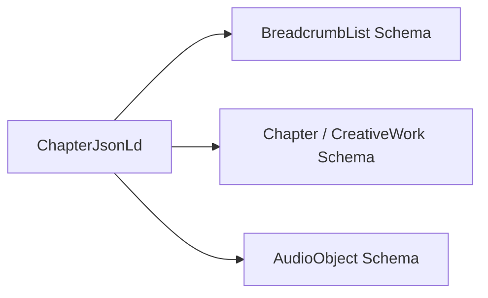

# Design Specification: Multilingual Surah SEO & Architecture Optimization

**Date**: 2026-09-13  
**Status**: Approved (Audited & Polished)  
**Target Systems**: Next.js Pages Router (SSR / SSG / ISR), i18n (`next-translate`), `next-seo`, Schema.org JSON-LD, Sitemap & Hreflang generation.  
**Scope**: URL structure, slug routing, canonicalization, localized search-intent titles, human-grade meta descriptions, Schema.org structured data, sitemap generation, and multilingual `hreflang` synchronization across all 21 supported languages with primary focus on Persian (`fa`), Arabic (`ar`), and English (`en`).

---

## 1. Objectives & Overview

### 1.1 Goals
1. **Organic Visibility & Keyword Rankings**: Maximize top-3 SERP rankings on Google for high-volume search terms in Persian (*"سوره بقره"*, *"متن و ترجمه سوره بقره"*, *"صوت سوره بقره"*), Arabic (*"سورة البقرة قراءة واستماع"*, *"تفسير سورة البقرة"*), and English (*"Surah Al-Baqarah read translation audio"*).
2. **Click-Through Rate (CTR) Elevation**: Replace generic page titles with localized, high-intent action-oriented titles (50–60 chars) and human-grade meta descriptions (140–160 chars).
3. **Structured Data Rich Snippets**: Implement Schema.org compliant `BreadcrumbList`, `Chapter`, and `AudioObject` JSON-LD to unlock breadcrumb and media rich snippets in Google Search.
4. **Zero Duplicate Content Penalty**: Consolidate numeric IDs (`/2`, `/fa/2`) into canonical slug URLs (`/al-baqarah`, `/fa/al-baqarah`) while preserving backward-compatible routing.
5. **Hreflang & Canonical URL Agreement**: Eliminate hreflang-to-redirect mismatches and ensure 100% parity across all 21 locales.

### 1.2 Problems Diagnosed & Solved
| Issue | Root Cause | Architectural Solution |
| :--- | :--- | :--- |
| **Numeric URL Pollution** | Internal links generated raw numeric IDs (`/2`, `/fa/2`), forfeiting slug keyword signals. | Standardize on `getSurahNavigationUrl(chapter.slug)` across all navigation components (`SurahList`, `QuickSurahJumps`, `ChapterHeader`, `EndOfSurahSection`, `SearchPreInput`). |
| **Client-Side Slug Latency** | `useChapterIdsByUrlPath` called the backend API `getChapterIdBySlug` over the network on every client-side slug route transition. | Implement in-memory synchronous slug lookup via `DataContext` (`chaptersData`) before falling back to async network calls. |
| **Hreflang Redirect Conflict** | `getLanguageAlternates` generated `${basePath}/en/slug` for English, which redirects to `${basePath}/slug`, triggering Google Search Console hreflang redirect errors. | Update `getLanguageAlternates` to align strictly with `getCanonicalUrl`, serving `/slug` for `en` without the `/en` prefix. |
| **Double Title Branding** | `createSEOConfig` specifies `titleTemplate: '%s - Quran.ir'`, causing pages with explicit suffixes (e.g. `... | قرآن کریم`) to render with redundant double branding (`... | قرآن کریم - Quran.ir`). | Normalize title generation to either integrate with `titleTemplate` or override `titleTemplate` cleanly on localized chapter pages. |
| **Range Canonical Contradiction** | `next.config.js` 301-redirects `/2:1-10` to `/2/1-10`, while `[chapterId]/index.tsx` generated canonical URLs as `/2:1-10`. | Standardize range canonical URLs to `/[chapterSlug]/[from]-[to]` (e.g. `/al-baqarah/1-10`) via `[chapterId]/[verseId]/index.tsx`. |
| **Incomplete JSON-LD Specs** | Missing Schema.org properties (`inLanguage`, `isPartOf`, audio MIME type specified as invalid `audio/mp3` instead of `audio/mpeg`, missing breadcrumb item URLs). | Implement fully compliant `ChapterJsonLd` component adhering to Google Search Central and Schema.org standards. |

---

## 2. Next.js Routing & Parameter Resolution Architecture

### 2.1 Route Map & Scope Disambiguation
Next.js Pages Router dynamic segments under `src/pages/` handle two distinct semantic patterns:

```mermaid
graph TD
    A["Request URL"] --> B{Pattern Match}
    B -->|"/al-baqarah" or "/2"| C["src/pages/[chapterId]/index.tsx"]
    B -->|"/al-baqarah/255" or "/2/255"| D["src/pages/[chapterId]/[verseId]/index.tsx"]
    B -->|"/al-baqarah/255/tafsirs"| E["src/pages/[chapterId]/[verseId]/tafsirs.tsx"]
    B -->|"/surah/al-baqarah/info"| F["src/pages/surah/[chapterId]/[...info].tsx"]
    B -->|"/2:255/reflections"| G["src/pages/[chapterId]/reflections.tsx (VerseKey Route)"]
    B -->|"/2:255/lessons"| H["src/pages/[chapterId]/lessons.tsx (VerseKey Route)"]
    B -->|"/2:255/tafsirs/1"| I["src/pages/[chapterId]/tafsirs/[tafsirId].tsx (VerseKey Route)"]
    
    C --> J["Props: chapterId = '2', slug = 'al-baqarah'"]
    D --> J
    E --> J
    F --> J
```

#### Route Matrix:
1. **Chapter-Scoped Routes**:
   - `src/pages/[chapterId]/index.tsx`: Accepts chapter numeric ID (`2`), slug (`al-baqarah`), Ayatul Kursi slug (`ayatul-kursi`), or verse-range fallback (`2:1-10`).
   - `src/pages/[chapterId]/[verseId]/index.tsx`: Accepts chapter slug/ID and verse number or range (`/al-baqarah/255`, `/al-baqarah/1-10`).
   - `src/pages/[chapterId]/[verseId]/tafsirs.tsx`: Chapter slug/ID with verse number tafsir view.
   - `src/pages/surah/[chapterId]/[...info].tsx`: Surah information and background details.
2. **VerseKey-Scoped Routes** (Historical dynamic segment naming where `params.chapterId` is a `verseKey` e.g. `"2:255"`):
   - `src/pages/[chapterId]/reflections.tsx`
   - `src/pages/[chapterId]/lessons.tsx`
   - `src/pages/[chapterId]/layers.tsx`
   - `src/pages/[chapterId]/qiraat.tsx`
   - `src/pages/[chapterId]/hadith.tsx`
   - `src/pages/[chapterId]/related-verses.tsx`
   - `src/pages/[chapterId]/answers/index.tsx`
   - `src/pages/[chapterId]/answers/[questionId].tsx`
   - `src/pages/[chapterId]/tafsirs/[tafsirId].tsx`

### 2.2 Server-Side Data Fetching (`getStaticProps` & `getStaticPaths`)
- **`getStaticPaths` Contract**:
  ```ts
  export const getStaticPaths: GetStaticPaths = async () => ({
    paths: [],
    fallback: 'blocking', // Server-render on-demand if cache misses, then cache via ISR for 7 days
  });
  ```
- **Dual Parameter Resolution in `getStaticProps`**:
  ```ts
  export const getStaticProps: GetStaticProps = async ({ params, locale }) => {
    const rawParam = String(params.chapterId);
    const chaptersData = await getAllChaptersData(locale);
    
    let numericChapterId: string | null = null;
    
    if (isValidChapterId(rawParam)) {
      numericChapterId = formatStringNumber(rawParam);
    } else {
      // 1. Fast in-memory slug resolution from local JSON
      const matchedChapter = Object.entries(chaptersData).find(
        ([, chapter]) => chapter.slug === rawParam.toLowerCase()
      );
      if (matchedChapter) {
        numericChapterId = matchedChapter[0];
      } else {
        // 2. Fallback to API resolver for legacy aliases
        const sluggedId = await getChapterIdBySlug(rawParam, locale);
        if (sluggedId) numericChapterId = sluggedId.toString();
      }
    }
    
    if (!numericChapterId || !chaptersData[numericChapterId]) {
      return { notFound: true, revalidate: REVALIDATION_PERIOD_ON_ERROR_SECONDS };
    }
    
    // Always pass numeric ID in chapterResponse.chapter.id for predictable child component consumption
    const chapter = { ...chaptersData[numericChapterId], id: numericChapterId };
    
    // ... API fetching ...
    
    return {
      props: {
        chaptersData,
        chapterResponse: { chapter },
        versesResponse,
        quranReaderDataType: QuranReaderDataType.Chapter,
      },
      revalidate: ONE_WEEK_REVALIDATION_PERIOD_SECONDS,
    };
  };
  ```

### 2.3 Client-Side Parameter Handling & Zero-Latency Memory Lookup
When navigating to `/al-baqarah`:
- `router.query.chapterId` evaluates to `'al-baqarah'`.
- `props.chapterResponse.chapter.id` evaluates to `'2'`.
- **`useChapterId.ts` Optimization Guarantee**:
  To prevent asynchronous network fetches on client navigation, `useChapterIdsByUrlPath` must perform an instantaneous synchronous lookup against `DataContext`:
  ```ts
  // In useChapterId.ts:
  const getChapterIdFromSlugOrId = (slugOrId: string, chaptersData: ChaptersData): string | null => {
    if (isValidChapterId(slugOrId)) return formatStringNumber(slugOrId);
    if (!chaptersData) return null;
    const found = Object.entries(chaptersData).find(
      ([, chapter]) => chapter.slug === slugOrId.toLowerCase()
    );
    return found ? found[0] : null;
  };
  ```
- **Child Components Safety**:
  Components receiving `chapterId` via props (e.g. `QuranReader id={chapterResponse.chapter.id}`) receive the normalized numeric ID `'2'`.
  Hooks parsing `router.query.chapterId` (such as `useReadingPreferenceSwitcher` and `useStartingVerseScrollTarget`) determine chapter-scoped mode via `!String(chapterId).includes(':')`, which evaluates to `true` for both `'2'` and `'al-baqarah'`.

---

## 3. Canonical URLs & Hreflang Alignment

### 3.1 Canonical URL Rules
- **Base Domain**: `https://quran.ir`
- **Default Locale (`en`)**: Unprefixed slug URL: `https://quran.ir/al-baqarah`
- **Non-Default Locales (`fa`, `ar`, `ur`, etc.)**: Prefixed slug URL: `https://quran.ir/fa/al-baqarah`
- **Numeric URL Canonicalization**: Visiting `https://quran.ir/2` or `https://quran.ir/fa/2` emits `<link rel="canonical" href="https://quran.ir/al-baqarah">` and `<link rel="canonical" href="https://quran.ir/fa/al-baqarah">` respectively.

### 3.2 Hreflang Generation Fix in `src/utils/locale.ts`
The previous implementation generated `${basePath}/${locale}${path}` for all locales, emitting `https://quran.ir/en/al-baqarah`. Because `/en/*` redirects to `/*`, search engines encountered hreflang tags pointing to 301/308 redirects.

**Corrected Implementation**:
```ts
export const getLanguageAlternates = (path: string): LinkLanguageAlternate[] => {
  const { locales, defaultLocale } = i18nConfig;
  const basePath = getBasePath();
  
  return locales
    .map((locale) => ({
      hrefLang: locale,
      href: `${basePath}${locale === defaultLocale ? '' : `/${locale}`}${path === '/' ? '' : path}`,
    }))
    .concat({
      hrefLang: 'x-default',
      href: `${basePath}${path === '/' ? '' : path}`,
    });
};
```

**Verification Table for `/al-baqarah`**:
| `hreflang` Attribute | Resolved Alternate URL | Canonical on Target Page | Status |
| :--- | :--- | :--- | :--- |
| `en` | `https://quran.ir/al-baqarah` | `https://quran.ir/al-baqarah` | 200 OK (Match) |
| `fa` | `https://quran.ir/fa/al-baqarah` | `https://quran.ir/fa/al-baqarah` | 200 OK (Match) |
| `ar` | `https://quran.ir/ar/al-baqarah` | `https://quran.ir/ar/al-baqarah` | 200 OK (Match) |
| `x-default` | `https://quran.ir/al-baqarah` | `https://quran.ir/al-baqarah` | 200 OK (Match) |

---

## 4. Title Tags & Search Intent Engineering

### 4.1 SERP Pixel & Character Budget
- **Desktop SERP Limit**: ~600px (~60 characters)
- **Mobile SERP Limit**: ~575px (~55 characters)
- **Title Template Architecture**:
  In `_app.tsx` / `AppContent.tsx`, `DefaultSeo` initializes with `createSEOConfig({ locale })` which applies `titleTemplate: '%s - Quran.ir'`.
  To prevent double suffixes on localized pages:
  - For English (`en`): Page title produces `Surah Al-Baqarah (The Cow) - Read, Translation & Audio`, resulting in `Surah Al-Baqarah (The Cow) - Read, Translation & Audio - Quran.ir`.
  - For Persian (`fa`) and Arabic (`ar`): When a localized brand suffix (e.g. `| قرآن کریم`) is desired, `titleTemplate` must be overridden with `undefined` or `null` in `NextSeoWrapper` on chapter pages, OR the title formula must format the brand directly without redundant appending.

### 4.2 Localized High-CTR Title Formulas

#### 1. Persian (`fa`):
- **Surah Page**:  
  `سوره بقره (Al-Baqarah) - متن، ترجمه و تلاوت صوتی | قرآن کریم` *(58 chars)*
- **Single Ayah**:  
  `آیه ۲۵۵ سوره بقره (آیت الکرسی) - متن و ترجمه | قرآن کریم` *(55 chars)*
- **Verse Range**:  
  `آیات ۱ تا ۱۰ سوره بقره - متن و ترجمه فارسی | قرآن کریم` *(53 chars)*

#### 2. Arabic (`ar`):
- **Surah Page**:  
  `سورة البقرة - قراءة واستماع وتفسير | القرآن الكريم` *(49 chars)*
- **Single Ayah**:  
  `سورة البقرة آية ۲۵۵ (آية الكرسي) - قراءة وتفسير | القرآن الكريم` *(61 chars)*
- **Verse Range**:  
  `سورة البقرة الآيات ۱ إلى ۱۰ - قراءة وتفسير | القرآن الكريم` *(56 chars)*

#### 3. English (`en`):
- **Surah Page**:  
  `Surah Al-Baqarah (The Cow) - Read, Translation & Audio` *(54 chars, renders as 65 chars with `- Quran.ir`)*
- **Single Ayah**:  
  `Surah Al-Baqarah - Verse 255 (Ayatul Kursi) - Translation` *(58 chars)*
- **Verse Range**:  
  `Surah Al-Baqarah Verses 1-10 - Read & Translation` *(49 chars)*

#### 4. Generic Multilingual Formula:
`{Surah} {TransliteratedName} ({TranslatedName}) - {ActionKeywords}`

---

## 5. Human-Grade Localized Meta Descriptions

### 5.1 Content Guidelines
- **Character Constraint**: 140–160 characters (trimmed to 150 chars by `truncateString` in `NextSeoWrapper`).
- **Keyword Inclusions**: Full text (*متن کامل*), Persian translation (*ترجمه فارسی*), audio recitation (*صوت / تلاوت*), tafsir (*تفسیر*), word-by-word (*کلمه به کلمه*), verse count, and revelation place.

### 5.2 Translation Templates (`locales/*/chapter.json`)

- **Persian (`locales/fa/chapter.json`)**:
  ```json
  "meta-description": "متن کامل و ترجمه فارسی سوره {{transliteratedName}} ({{translatedName}}) همراه با تلاوت صوتی، تفسیر و معنی کلمات. سوره {{chapterOrder}} با {{versesCount}} آیه نازل شده در {{revelationPlace}}."
  ```
- **Arabic (`locales/ar/chapter.json`)**:
  ```json
  "meta-description": "اقرأ واستمع إلى سورة {{transliteratedName}} كاملة مع التفسير والتلاوة الصوتية العذبة. سورة رقم {{chapterOrder}} وعدد آياتها {{versesCount}} آية نزلت في {{revelationPlace}}."
  ```
- **English (`locales/en/chapter.json`)**:
  ```json
  "meta-description": "Read, study, and listen to Surah {{transliteratedName}} ({{translatedName}}) with English translation, tafsir, and audio recitation. Chapter {{chapterOrder}} with {{versesCount}} verses revealed in {{revelationPlace}}."
  ```

---

## 6. Schema.org JSON-LD Structured Data

### 6.1 Component Architecture (`ChapterJsonLd.tsx`)
A dedicated, zero-dependency component `ChapterJsonLd` renders structured data into `<Head>` using `dangerouslySetInnerHTML`.



### 6.2 Schema Specifications

#### 1. `BreadcrumbList` Schema
```json
{
  "@context": "https://schema.org",
  "@type": "BreadcrumbList",
  "itemListElement": [
    {
      "@type": "ListItem",
      "position": 1,
      "name": "قرآن کریم",
      "item": "https://quran.ir/fa"
    },
    {
      "@type": "ListItem",
      "position": 2,
      "name": "سوره بقره (Al-Baqarah)",
      "item": "https://quran.ir/fa/al-baqarah"
    }
  ]
}
```

*For Single Verse Pages (`/fa/al-baqarah/255`):*
```json
{
  "@context": "https://schema.org",
  "@type": "BreadcrumbList",
  "itemListElement": [
    {
      "@type": "ListItem",
      "position": 1,
      "name": "قرآن کریم",
      "item": "https://quran.ir/fa"
    },
    {
      "@type": "ListItem",
      "position": 2,
      "name": "سوره بقره",
      "item": "https://quran.ir/fa/al-baqarah"
    },
    {
      "@type": "ListItem",
      "position": 3,
      "name": "آیه ۲۵۵ (آیت الکرسی)",
      "item": "https://quran.ir/fa/al-baqarah/255"
    }
  ]
}
```

#### 2. `Chapter` (Book Section) Schema
```json
{
  "@context": "https://schema.org",
  "@type": "Chapter",
  "@id": "https://quran.ir/fa/al-baqarah#chapter",
  "name": "سوره بقره (Al-Baqarah)",
  "alternateName": [
    "البقرة",
    "Al-Baqarah",
    "The Cow",
    "بقره (گاو ماده)"
  ],
  "position": 2,
  "inLanguage": "fa",
  "url": "https://quran.ir/fa/al-baqarah",
  "description": "متن کامل و ترجمه فارسی سوره بقره...",
  "isPartOf": {
    "@type": "Book",
    "@id": "https://quran.ir#quran",
    "name": "القرآن الكريم",
    "url": "https://quran.ir",
    "inLanguage": "ar"
  }
}
```

#### 3. `AudioObject` Schema
```json
{
  "@context": "https://schema.org",
  "@type": "AudioObject",
  "name": "تلاوت صوتی سوره بقره",
  "description": "تلاوت صوتی سوره بقره با صدای مشاری راشد العفاسی",
  "contentUrl": "https://download.quranicaudio.com/qdc/mishari_al_afasy/complete/002.mp3",
  "encodingFormat": "audio/mpeg",
  "inLanguage": "ar",
  "creator": {
    "@type": "Person",
    "name": "Mishari Rashid Al-Afasy"
  },
  "publisher": {
    "@type": "Organization",
    "name": "Quran.ir",
    "url": "https://quran.ir"
  }
}
```

---

## 7. Sitemap & Special Edge Case Handling

### 7.1 Sitemap Enumeration Strategy (`next-sitemap.js`)
- **Execution Workflow**:
  1. `next-sitemap` builds static XML files mapping all 114 Surah canonical slugs across 21 locales.
  2. Alternate references are generated with the `-remove-from-here` marker.
  3. `scripts/format-sitemap.js` strips temporary suffixes to produce clean, absolute multilingual URLs.

### 7.2 Special Route Edge Cases
1. **Ayatul Kursi (`/ayatul-kursi`)**:
   - `[chapterId]/index.tsx` detects `AYAH_KURSI_SLUGS = ['ayatul-kursi', 'آیت الکرسی']`.
   - The canonical URL is `https://quran.ir/ayatul-kursi` (or `https://quran.ir/fa/ayatul-kursi`).
   - `next-sitemap.js` excludes `/al-baqarah/255` from XML in favor of `/ayatul-kursi` with full localized `alternateRefs`.
2. **Verse Range Routes (`/2:1-10` vs `/al-baqarah/1-10`)**:
   - `next.config.js` maintains 301 permanent redirects for legacy colon ranges (`/:surah\\::from(\\d{1,})\\::to(\\d{1,})` -> `/:surah/:from-:to`).
   - The canonical URL is always formatted as `https://quran.ir/al-baqarah/1-10` (or `https://quran.ir/fa/al-baqarah/1-10`).
3. **Dedicated Sub-pages Matrix**:
   - Info pages: `https://quran.ir/surah/al-baqarah/info` (and `/fa/surah/al-baqarah/info`).
   - Verse tafsir hub: `https://quran.ir/al-baqarah/255/tafsirs`.
   - Direct tafsir view: `https://quran.ir/2:255/tafsirs/en-tafisr-ibn-kathir`.

---

## 8. Implementation & Verification Plan

### 8.1 Implementation Checklist
- [x] **Routing & Navigation**:
  - Verify `getSurahNavigationUrl` and `getVerseNavigationUrl` produce kebab-case slug URLs.
  - Update internal links across navigation drawers, cards, and headers.
- [x] **Client-Side Optimization**:
  - Add in-memory `DataContext` lookup in `useChapterId.ts` before network API fallback.
- [x] **Canonical & Hreflang Alignment**:
  - Update `getLanguageAlternates` in `src/utils/locale.ts` to output clean root URLs for `defaultLocale` (`en`).
  - Align canonical URLs on range views and Ayatul Kursi.
- [x] **Search Intent Titles & Meta**:
  - Implement `getSEOTitle()` with localized keywords in `[chapterId]/index.tsx` and `[chapterId]/[verseId]/index.tsx`.
  - Update `locales/*/chapter.json` with human-grade meta descriptions.
- [x] **Structured Data (JSON-LD)**:
  - Create `src/components/JsonLd/ChapterJsonLd.tsx` supporting `BreadcrumbList`, `Chapter`, and `AudioObject`.
  - Embed `ChapterJsonLd` in `[chapterId]/index.tsx`.
- [x] **Sitemap Verification**:
  - Run `node scripts/format-sitemap.js` and verify output XML for valid hreflang entries without `-remove-from-here`.

### 8.2 Verification & Testing Protocols
1. **Automated Unit Tests**:
   - `yarn test src/utils/navigation.test.ts` (Verify slug output for IDs and slugs).
   - `yarn test src/utils/locale.test.ts` (Verify hreflang alternates for `en`, `fa`, `ar`).
   - `yarn test src/components/JsonLd/ChapterJsonLd.test.tsx` (Validate Schema.org JSON structure).
2. **DOM & SEO Head Audits**:
   - Verify `<title>`, `<meta name="description">`, `<link rel="canonical">`, and `<link rel="alternate" hreflang="...">` on:
     - `http://localhost:3000/al-baqarah`
     - `http://localhost:3000/2`
     - `http://localhost:3000/fa/al-baqarah`
     - `http://localhost:3000/fa/2`
     - `http://localhost:3000/ayatul-kursi`
3. **Google Rich Results Validation**:
   - Validate generated JSON-LD output against [Google Rich Results Test](https://search.google.com/test/rich-results) for `BreadcrumbList`, `Chapter`, and `AudioObject` zero-error compliance.
4. **Typecheck & Regression Guard**:
   - Run `npx tsc --noEmit` to ensure complete type safety.
   - Run full test suite: `yarn --ignore-engines test --run`.

