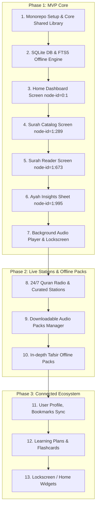

# Quran.ir Mobile App Architecture & Design Specification (iOS & Android)

## 1. Overview & Objectives

This document specifies the technical architecture, design system mapping, and phased delivery plan for the official **Quran.ir Mobile Application** (iOS & Android).

The mobile app brings the **Sanctuary Design System** (ambient emerald glow, clean Islamic aesthetics, fluent Persian & Arabic typography, and offline capability) to mobile devices, matching the user-provided Figma designs.

---

## 2. Figma Design Catalog & Screen Mapping

- **Figma File Key**: `bjazbvmSGAXdNebD3ctv36`
- **Figma Document Title**: `AppHome`

| Screen Name | Figma Link | Node ID | Core Features & Responsibilities |
| :--- | :--- | :--- | :--- |
| **1. Home Dashboard** | [Figma Home](https://www.figma.com/design/bjazbvmSGAXdNebD3ctv36/AppHome?node-id=0-1) | `0:1` | Sanctuary greeting header, ambient radial glow, Resume Reading ribbon, Daily Ayah / Juz progress, Quick access pills, Prayer/Reciter quick bar, bottom navigation. |
| **2. Surah Catalog** | [Figma SurahList](https://www.figma.com/design/bjazbvmSGAXdNebD3ctv36/AppHome?node-id=1-289) | `1:289` | 114 Surahs listing, Juz / Hizb index, Revelation order tabs, Search Command Bar, Makki/Madani badges, localized names and ayah counts. |
| **3. Surah Reader** | [Figma SurahView](https://www.figma.com/design/bjazbvmSGAXdNebD3ctv36/AppHome?node-id=1-673) | `1:673` | Dual-mode reading engine (Continuous reflowable text + 604-page physical Mushaf), Bismillah calligraphy header, Word-by-Word highlighting, bottom synchronized playback bar. |
| **4. Ayah Insights** | [Figma AyahInsights](https://www.figma.com/design/bjazbvmSGAXdNebD3ctv36/AppHome?node-id=1-995) | `1:995` | Interactive verse modal/sheet, Persian & English translations, Tafsir Nemoneh / Al-Mizan, Word roots & morphology, community reflections (QuranReflect), audio repeat controls. |

---

## 3. Technology Stack & Foundation Choices

Based on architectural trade-off analysis and project goals:

1. **Framework**: **React Native with Expo SDK 52+**
   - Enables direct sharing of TypeScript interfaces, Redux slices, local JSON datasets, and translation catalogs from the web application.
   - Fast cross-platform builds with EAS (Expo Application Services).
2. **Audio Engine**: **`react-native-track-player`**
   - Native audio playback service backed by iOS `AVQueuePlayer` and Android `ExoPlayer`.
   - Continuous background playback, lock-screen widget, system notifications with reciter/surah artwork, and remote control events.
3. **Offline Database**: **OP-SQLite / Expo SQLite with FTS5**
   - C++ SQLite binding providing sub-millisecond query execution.
   - Bundled pre-indexed database (`quran.db`) containing Arabic Uthmani text, Persian/English translations, and Persian word-by-word dataset.
   - FTS5 full-text search with Persian orthography normalization (Kaf/Yeh unification, diacritics removal).
4. **Key-Value Store**: **`react-native-mmkv`**
   - Blazing fast synchronous storage for user settings (last read verse, preferred reciter, font size, theme mode).
5. **Typography Engine**:
   - Pre-bundled fonts: `UthmanicHafs.otf`, `IndoPakNastaliq.ttf`, and `Vazirmatn.ttf` (Persian UI).
   - High-precision RTL layout with CSS logical properties.

---

## 4. Multi-Phase Roadmap

---

## 5. Screen Specifications (One-by-One Plan)

### Step 1: Foundation & Shared Core
- Setup `apps/mobile` Expo workspace in the repository.
- Link shared data (`data/qdc/`), translations (`locales/`), and TypeScript models (`types/`).
- Build SQLite schema with `verses`, `chapters`, `translations`, and `words` tables.

### Step 2: Home Screen (`node-id=0-1`)
- Ambient emerald header with dynamic greeting (*صبح بخیر / عصر بخیر*).
- Continue Reading card with Surah name, Ayah number, and progress bar.
- Quick navigation pills (سوره بقره، یس، الرحمن، جزء ۳۰).
- Daily Ayah card with reflection snippet.
- Bottom Tab Bar (خانه، سوره‌ها، جستجو، نشانه‌ها، تنظیمات).

### Step 3: Surah Catalog Screen (`node-id=1-289`)
- Tab switcher (سوره‌ها / جزءها / نزول).
- Command search bar with real-time Persian/Arabic search.
- Surah list card item with Surah number, Arabic calligraphy, Persian name, Makki/Madani badge, and ayah count.

### Step 4: Surah Reader Screen (`node-id=1-673`)
- View mode toggle (پیوسته / مصحف چاپی).
- Bismillah calligraphic banner.
- Verse cards with Uthmani/IndoPak sacred text, Persian translation, and Word-by-Word inline view.
- Floating bottom audio control bar with play/pause, next/prev ayah, and reciter picker.

### Step 5: Ayah Insights (`node-id=1-995`)
- Bottom sheet drawer triggered on verse tap.
- Multi-translation selector (مکارم، انصاریان، الهی قمشه‌ای، Saheeh).
- Tafsir tab with Tafsir Nemoneh and Al-Mizan.
- Audio repeat loop controls (تکرار ۱ تا ۵ بار).
