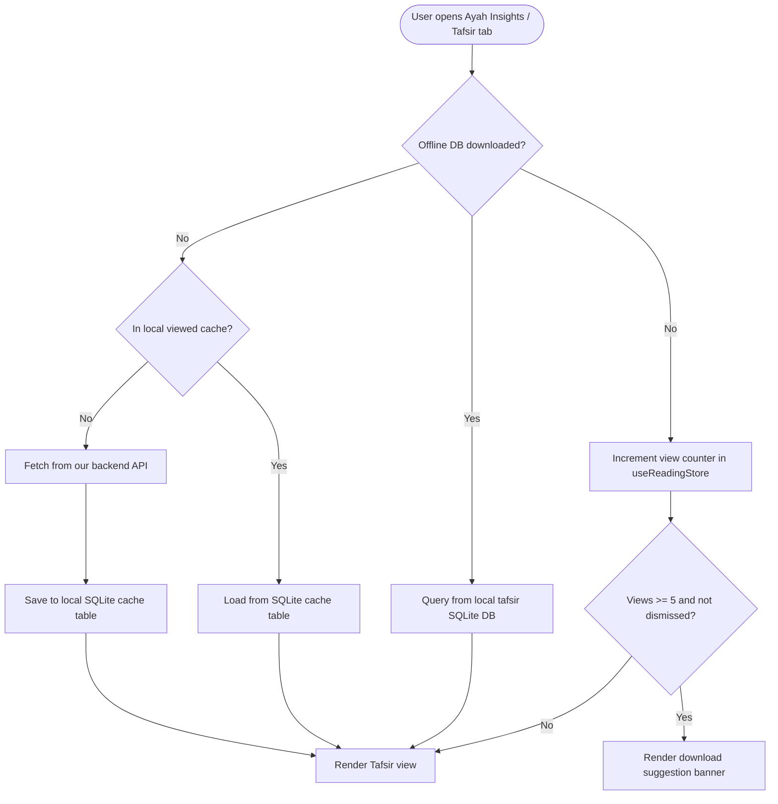

# Persian Quran Tafsir Engine, Sovereign Backend API & Mobile Download Manager Specification

## 1. Overview & Objective

Quran.ir aims to provide authentic, scholarly Persian Quran Tafsir (_Tafsir Nemouneh_ by Ayatollah
Naser Makarem Shirazi and _Tafsir Noor_ by Hojjat al-Islam Mohsen Ghara'ati) to both Web and Mobile
users.

### User Requirements

1. **Sovereign Backend API**: Build a self-contained local backend API matching the
   Quran.com/QuranCDN standard (`/api/proxy/content/api/qdc/tafsirs/:tafsirId/by_ayah/:verseKey`),
   fully hosted on our infrastructure with zero reliance on external third parties.
2. **On-Demand Mobile SQLite Download**: Do not bundle the massive full multi-volume Tafsir database
   (~15-25MB) into the initial mobile app bundle. Allow users to download and manage it on-demand in
   **Settings** («دانلود تفاسیر برای استفاده آفلاین»).
3. **Hybrid Smart Resolution**:
   - If the user has downloaded the offline Tafsir SQLite database: query directly from local
     storage with instant 0ms latency and 100% offline availability.
   - If not downloaded: fetch individual verses on-the-fly from our sovereign backend API
     (`/tafsirs/:id/by_ayah/:verseKey`) and cache viewed verses in a local SQLite cache table for
     future offline recall.
4. **Frequent-User Nudge**:
   - If an active user opens the Ayah Insights / Tafsir tab frequently (e.g. >= 5 times) without
     having downloaded the offline package, display a polite, non-intrusive banner or badge offering
     one-tap navigation to Settings to download the complete offline dataset.

---

## 2. API Contract & Architectural Design

### 2.1 Backend Endpoint Specification

Matching Quran.com / QuranCDN standard with enhanced support for structured points:

- **URL**: `GET /api/proxy/content/api/qdc/tafsirs/:tafsirIdOrSlug/by_ayah/:verseKey`
- **Supported Tafsirs**:
  - `171` / `fa-tafsir-nemouneh`: _تفسیر نمونه_ (آیت‌الله ناصر مکارم شیرازی)
  - `172` / `fa-tafsir-noor`: _تفسیر نور_ (حجت‌الاسلام محسن قرائتی)
  - `169` / `en-tafisr-ibn-kathir`: _Ibn Kathir (Abridged)_ (English fallback)
- **Response Format**:

```json
{
  "tafsir": {
    "resource_id": 171,
    "resource_name": "تفسیر نمونه",
    "language_id": 106,
    "slug": "fa-tafsir-nemouneh",
    "translated_name": {
      "name": "تفسیر نمونه",
      "language_name": "persian"
    },
    "verses": {
      "1:1": {
        "id": 1,
        "verse_number": 1,
        "verse_key": "1:1"
      }
    },
    "text": "سوره حمد سرآغاز کتاب جامع الهی است...",
    "points": [
      "هر کار معناداری باید با نام و یاد خدا آغاز شود تا از زوال و ابتری مصون ماند.",
      "رحمت الهی سرلوحه نظام هستی و آغازگر کتاب جامع هدایت است."
    ]
  }
}
```

### 2.2 Downloadable Offline Package Endpoint

- **URL**: `GET /api/proxy/content/api/qdc/download/tafsirs/:tafsirSlug.db`
- Serves pre-indexed, compressed SQLite database containing complete 6,236 verses of the requested
  Persian Tafsir.

---

## 3. Mobile Architecture

### 3.1 Data Flow



### 3.2 Settings UI Additions

In `mobile/src/app/(tabs)/settings.tsx`:

- New card section: **«تفاسیر قرآن کریم و استفاده آفلاین»**
- Lists available Persian Tafsirs with size (~12MB for _تفسیر نمونه_, ~10MB for _تفسیر نور_).
- Actions:
  - «دانلود برای استفاده آفلاین» (with Progress Bar).
  - «حذف فایل آفلاین» (to free up device storage).
  - Storage consumption status.

### 3.3 Frequent-User Banner

In `mobile/src/components/insights/TafsirTabContent.tsx`:

- When `tafsirOpenCount >= 5` and `!isDownloaded` and `!isBannerDismissed`:
  - Renders a clean banner with download icon and button: «دانلود نسخه آفلاین در تنظیمات».
  - Includes close button to dismiss if the user prefers online fetching.
